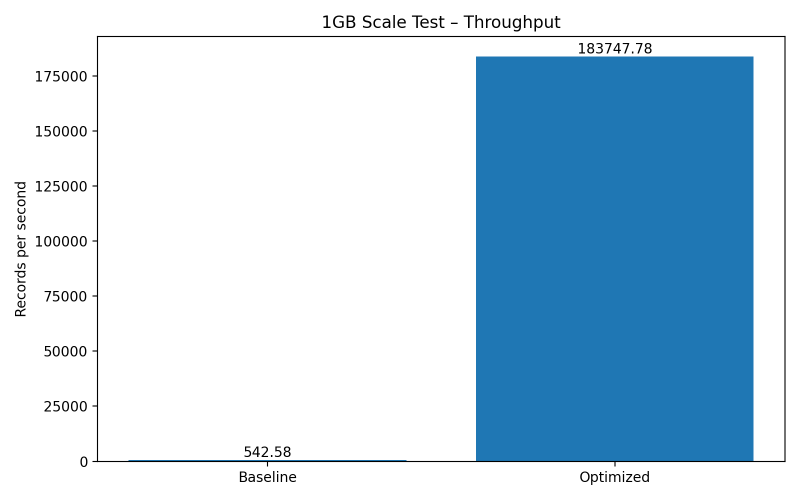
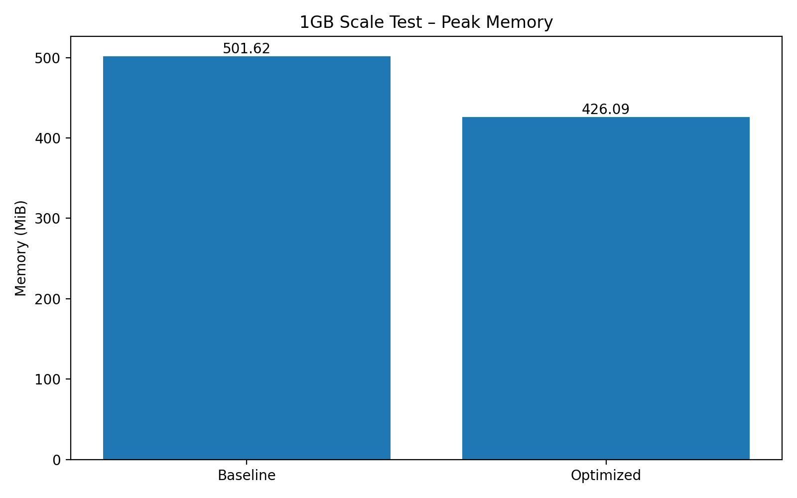
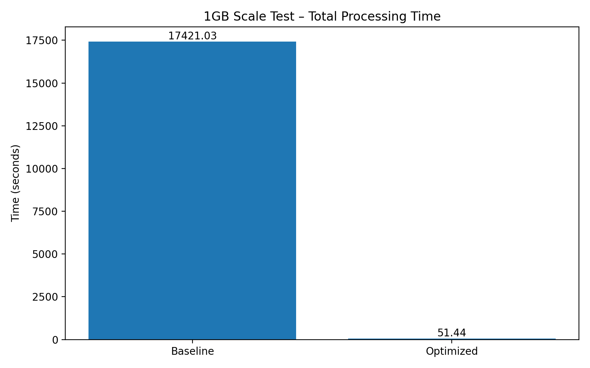

# 1GB Network Traffic Scale Testing Report

## 1. Scope
Scale testing was conducted on a generated 1GB CSV dataset.
Only the 1GB workload is included in this report.

- Total records: 9,452,387
- Training CSV records: 4,444,443
- Test CSV records: 5,007,944
- Platform: macOS-26.7.1-arm64-arm-64bit
- Python: 3.12.10
- Hardware: Apple MacBook Air M5, 16GB RAM

## 2. Inference Performance

| Metric | Baseline | Optimized |
|---|---:|---:|
| Records | 9,452,387 | 9,452,387 |
| Throughput (records/sec) | 542.58 | 183,747.78 |
| Elapsed time (seconds) | 17,421.03 | 51.44 |
| Peak RSS (MiB) | 501.62 | 426.09 |
| Errors | 0 | 0 |

Observed throughput ratio: **338.65x**

Peak memory reduction: **15.06%**

The throughput ratio compares the measured end-to-end benchmark
runs. The baseline and optimized execution paths differ, so this
ratio should not be described as a universal speedup.

Latency percentiles are not directly comparable: baseline measures
individual classification calls, while optimized measures batches.

## 3. Prediction Parity

- Training records compared: 4,444,443
- Test records compared: 5,007,944
- Total compared: 9,452,387
- Train predictions identical: True
- Test predictions identical: True
- Errors: 0

Both modes produced identical predictions on all tested records.

## 4. Training Benchmark

- Elapsed time: 5,990.39 seconds
- Peak RSS: 8.52 GiB
- Cross-validation wall time: 4,894.97 seconds
- Final fitting time: 780.89 seconds
- Final prediction time: 401.67 seconds

Evaluation metrics observed in the training logs:

| Model | Known F1 | Unknown F1 | ROC-AUC |
|---|---:|---:|---:|
| Random Forest | 0.9019 | 0.8967 | 0.9623 |
| XGBoost | 0.9096 | 0.9040 | 0.9682 |

Training and evaluation completed, but the benchmark exited with
a PicklingError during Random Forest model serialization.
The generated 2-byte rf.joblib is invalid and must not be used.
This benchmark is therefore a partial success, not a clean run.

## 5. Performance Graphs

## 6. Bottlenecks and Limitations

- Baseline performs individual classification calls.
- Optimized inference uses batch processing.
- Both runs were predominantly CPU-bound.
- The generated dataset does not establish performance on live traffic.
- The observed throughput ratio is specific to this workload and setup.
- Training instrumentation caused a final serialization failure.
- Only the 1GB dataset was tested.

## 7. Conclusion

The optimized inference implementation processed all 9,452,387
records with zero processing errors and exact prediction parity.
It achieved substantially higher observed throughput and lower
peak memory consumption than the baseline in this benchmark.

## 8. Additional Optimization Experiment

A precomputed class-index dictionary was introduced in batch inference
to avoid repeatedly searching the model class list when retrieving
confidence scores.

Validation:
- Python syntax check: passed
- Automated tests: 11 passed
- Additional direct parity check: 10,000 records
- Prediction mismatches: 0

Performance comparison:

| Metric | Previous optimized | Updated optimized |
|---|---:|---:|
| Throughput (records/sec) | 183747.78 | 181718.69 |
| Elapsed time (seconds) | 51.44 | 52.02 |
| Peak memory (MiB) | 426.09 | 436.19 |

The experiment did not demonstrate a measurable performance
improvement. The change is retained as a code-level lookup
optimization, not claimed as a benchmark speedup.

The updated implementation was checked for exact prediction
parity on 10,000 test records. Full 1GB parity after this
specific code change remains to be verified.

## 9. Training Serialization Fix

The benchmark timing instrumentation was changed to use class-level
wrappers rather than attaching local timing functions to model
instances.

- Random Forest instrumented save/load test: passed
- XGBoost instrumented save/load test: passed
- Existing automated tests: 11 passed

The full training benchmark was not rerun after this fix.

## 10. Repository Integration Notes

The class-level prediction timing wrappers and precomputed class-index
lookup are integrated in the benchmark source. Focused tests cover
instrumented model serialization, isolated model-output paths, confidence
parity with the baseline, rule precedence, and override behavior.

Full training after the serialization fix and full-dataset parity after
the latest inference optimization remain unverified. The benchmark result
files and charts are included alongside this report; generated CSVs,
training logs, and the invalid 2-byte model are intentionally not included.
